# 18 developer tools I use to improve my workflow

Every few months I find some tool that makes one small part of development less painful.

Sometimes it is for debugging performance. Sometimes it is for responsive testing. Sometimes it is just a better way to draw a quick diagram or test an API before the backend is ready.

So this post is a combination of tools and resources I use, or keep close, to improve my development workflow. Not every tool here is something everyone needs. But each one solves a real problem that comes up when building, testing, explaining, or maintaining software.

If you already use any of these, feel free to share your view too. It is always helpful to know how other developers are using the same tools in their day-to-day work.

## 1. [Angular Render Scan](https://www.npmjs.com/package/angular-render-scan)

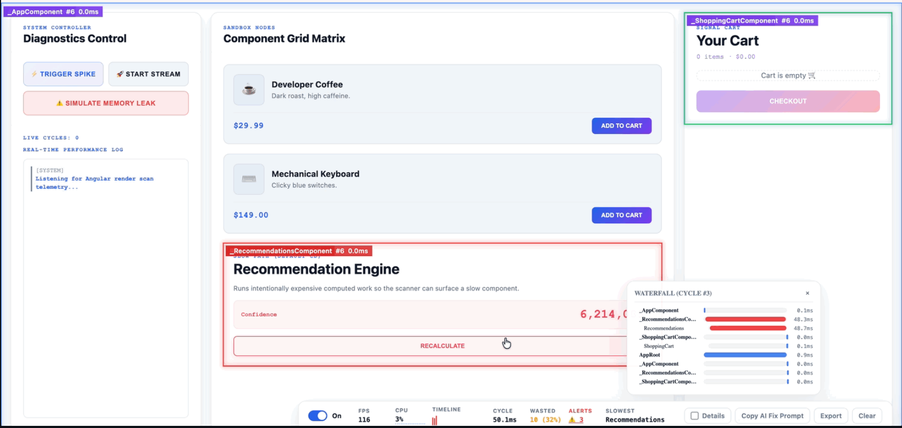

Angular Render Scan helps debug Angular change detection and component renders visually.

If you work with Angular, you know this pain. A page feels slow, but from the code it is not always clear which component is rendering too much. Instead of guessing, this tool helps you see render activity directly.

I like this kind of tool because it makes performance debugging less abstract. You can look at the UI and quickly understand where to focus.

I would use it for:

- finding components that render too often
- debugging change detection issues
- checking slow Angular screens
- improving performance without random code changes

## 2. [Multi Device Viewer](https://chromewebstore.google.com/detail/jfcnekmenjickfihkniaoaklehjmdhdb?utm_source=item-share-cb)

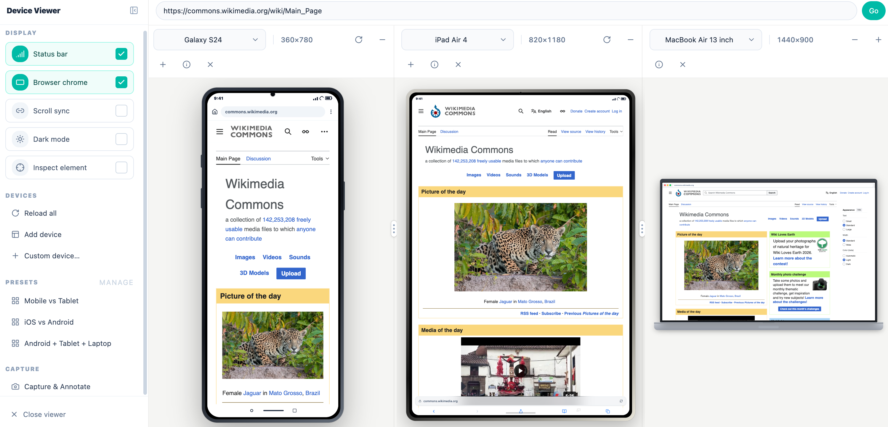

Multi Device Viewer is a Chrome extension for checking responsive layouts across multiple devices at the same time.

This is one of those problems I kept facing while building projects. I would test one mobile size, then tablet, then desktop, then again come back to mobile because one small CSS change broke something else.

With this extension, I can preview multiple screen sizes side by side. It also supports device frames, orientation switching, screenshots, and annotations, which helps when I need to explain a layout issue clearly.

I would use it for:

- checking mobile, tablet, laptop, desktop, and custom sizes
- comparing breakpoints side by side
- capturing screenshots for feedback
- spotting responsive issues without resizing the browser again and again

## 3. [React Scan](https://react-scan.com/)

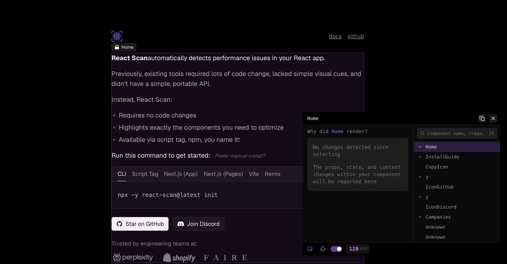

React Scan is useful for finding performance issues in React apps.

React performance debugging can get confusing when the app grows. Sometimes the issue is not one big mistake, but many small unnecessary renders. React Scan makes that easier to notice by highlighting components that need attention.

It is a nice tool to keep around when a React screen feels slower than expected and you want a quick visual clue.

I would use it for:

- detecting unnecessary renders
- finding components that need optimization
- debugging React performance visually
- checking whether a change improved or worsened rendering

## 4. [ToDiagram](https://todiagram.com/editor)

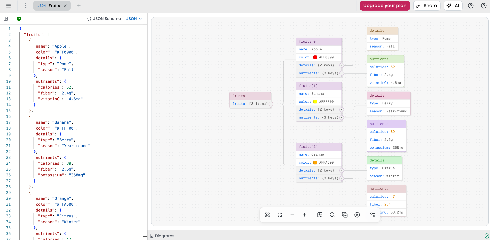

ToDiagram is useful when data is technically readable, but still hard to understand.

JSON, YAML, XML, CSV, and Mermaid can all become messy when the structure gets bigger. Seeing that data as a diagram makes it much easier to understand relationships and nested structures.

This is helpful when I am looking at API responses, config files, schemas, or any data shape that needs a visual map.

I would use it for:

- visualizing JSON or YAML
- understanding nested data
- explaining payloads to someone else
- turning structured data into diagrams quickly

## 5. [diagrams.net](https://app.diagrams.net/)

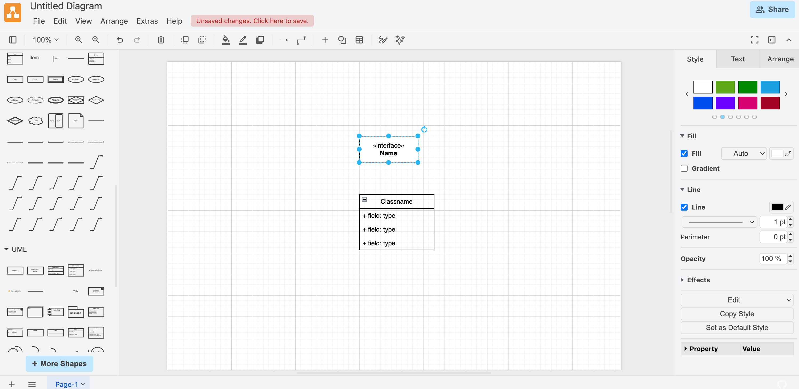

diagrams.net, also known as draw.io, is one of the tools I keep coming back to.

It is not fancy in a distracting way. It just does the job. You can create flowcharts, architecture diagrams, UML diagrams, ER diagrams, network diagrams, and database schemas without needing a heavy setup.

When I need a clean diagram for a document or discussion, this is usually enough.

I would use it for:

- architecture diagrams
- database schema diagrams
- flowcharts
- explaining systems visually

## 6. [Excalidraw](https://excalidraw.com/)

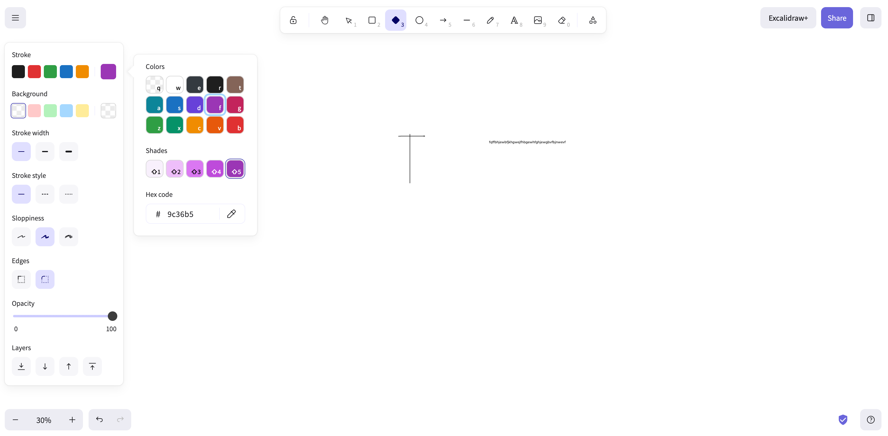

Excalidraw is great when the diagram does not need to look too formal.

I use this kind of tool when I want to explain an idea quickly. The hand-drawn style makes it feel less like a final document and more like a working thought.

It is perfect for rough architecture, UI flows, planning notes, and quick discussions.

I would use it for:

- sketching ideas
- drawing rough system flows
- making casual architecture notes
- explaining something without over-polishing it

## 7. [Jam](https://jam.dev/)

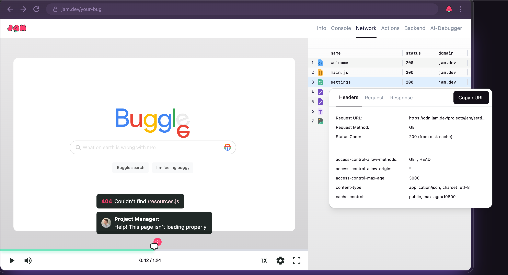

Jam makes bug reporting much easier.

Instead of sending a message like "this page is broken", you can record the issue and share useful debugging context with it. It can capture things like browser details, console logs, network logs, and reproduction steps.

This reduces a lot of back and forth between developers, QA, and product people.

I would use it for:

- reporting bugs with proper context
- capturing console and network logs
- sharing reproduction steps
- making debugging faster for the person fixing the issue

## 8. [Beeceptor](https://beeceptor.com/)

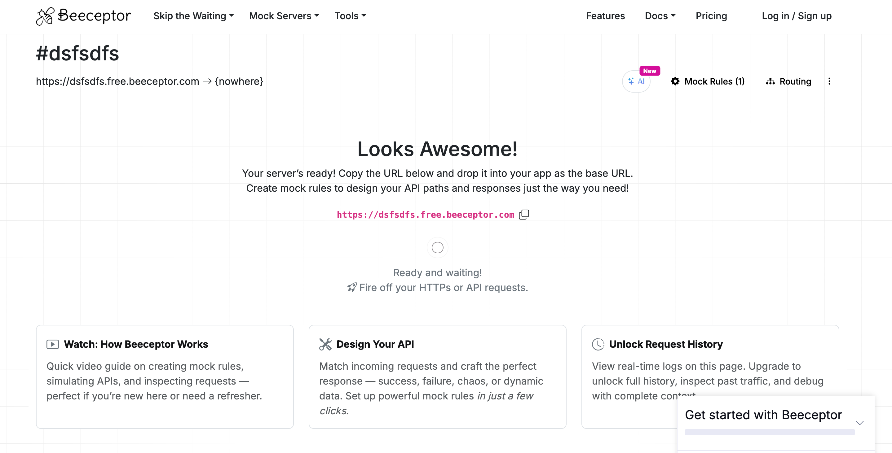

Beeceptor is useful when you need a mock API quickly.

There are many times when frontend work is ready, but the backend is not. Or maybe you want to test how your app behaves when an API is slow, fails, or returns a different response.

Mock endpoints make that work much easier. Beeceptor also helps with webhook testing and request inspection, which is very useful during integrations.

I would use it for:

- creating mock REST or GraphQL APIs
- testing webhooks
- simulating API delays and failures
- continuing frontend work without waiting for backend changes

## 9. [AFFiNE](https://affine.pro/)

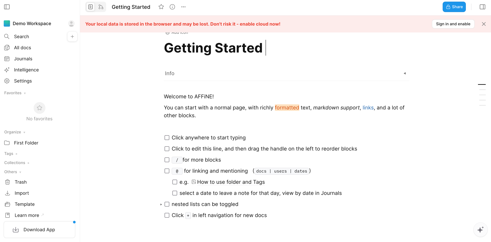

AFFiNE is an open-source workspace that combines docs, whiteboards, and databases.

I like tools that let me write and draw in the same place. Some ideas start as text, but later need a whiteboard. Some planning starts visually, then becomes notes or tasks.

AFFiNE fits that kind of mixed workflow well.

I would use it for:

- project notes
- whiteboards
- planning tasks
- keeping a personal or team knowledge base

## 10. [fish shell](https://fishshell.com/)

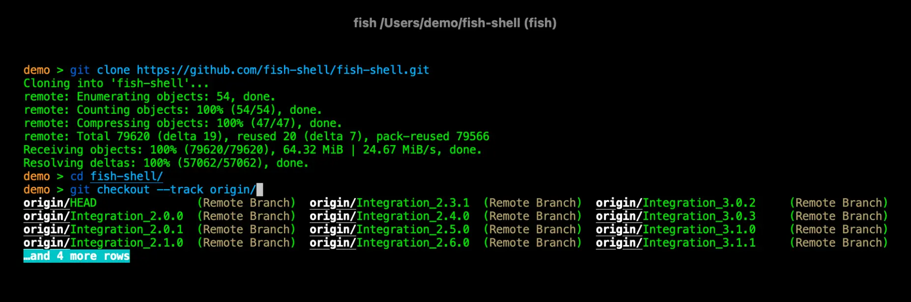

fish is a command line shell with good defaults.

If you spend a lot of time in the terminal, small improvements matter. Autosuggestions, tab completions, syntax highlighting, and cleaner scripting can save a surprising amount of time.

It is not a tool that changes your whole workflow overnight, but it makes daily terminal work smoother.

I would use it for:

- better command suggestions
- faster terminal navigation
- cleaner shell scripting
- improving the daily command line experience

## 11. [Free Public APIs](https://www.freepublicapis.com/)

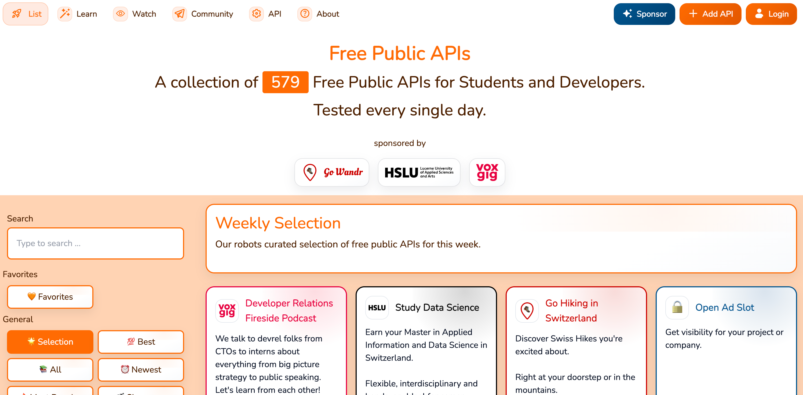

Free Public APIs is a directory of public APIs.

This is useful when you want to build a demo, practice API integration, or test a frontend idea without creating your own backend first.

Many side projects slow down because we spend too much time thinking about data. A public API directory helps you start faster.

I would use it for:

- finding APIs for side projects
- practicing API integration
- building frontend demos
- exploring public data sources

## 12. [Polypane](https://webcurate.co/polypane)

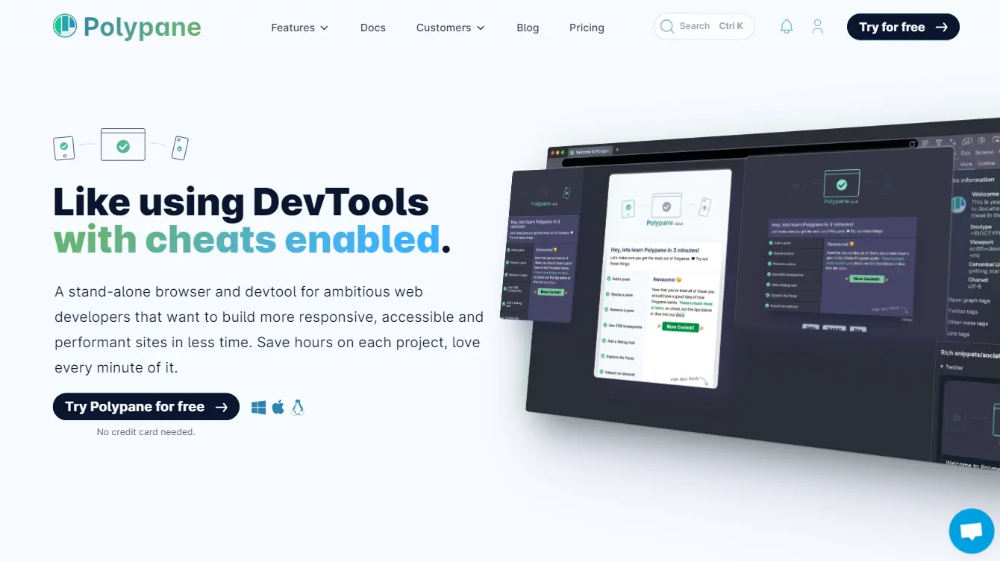

Polypane is a browser built for web development and responsive testing.

It helps you view different screen sizes at the same time and check things like responsiveness, accessibility, and site quality. For frontend work, that saves time because you do not have to keep jumping between device sizes manually.

This is useful when you want a more focused testing setup than normal browser resizing.

I would use it for:

- testing multiple screen sizes
- checking responsive layouts
- reviewing accessibility issues
- debugging frontend pages in a dedicated browser

## 13. [Skills](https://www.skills.sh/)

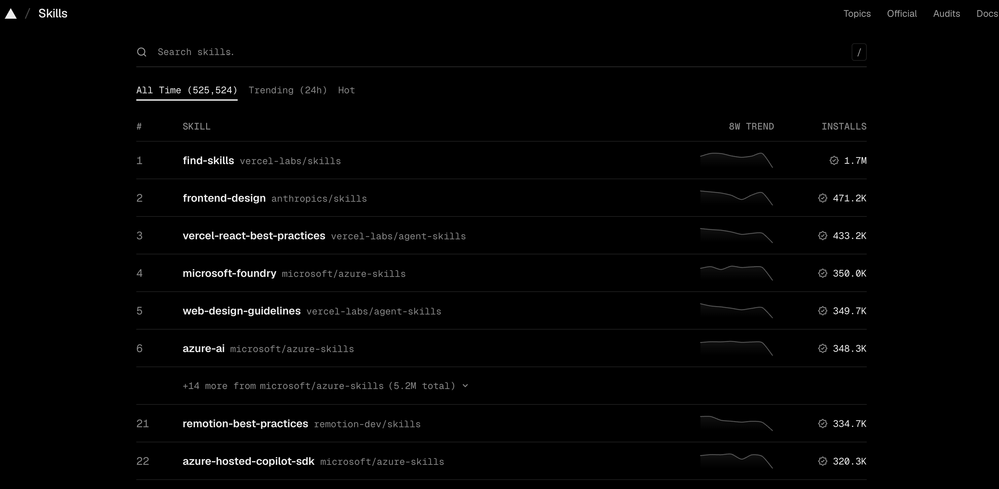

Skills is a directory for reusable capabilities for AI agents.

If you use coding agents, you probably know that instructions matter a lot. A good workflow can make the agent more useful, but writing the same instructions again and again is boring.

Skills are interesting because they package that kind of procedural knowledge so it can be reused.

I would use it for:

- discovering agent skills
- improving coding-agent workflows
- reusing common instructions
- making repeated AI workflows more consistent

## 14. [AI Directories](https://github.com/best-of-ai/ai-directories)

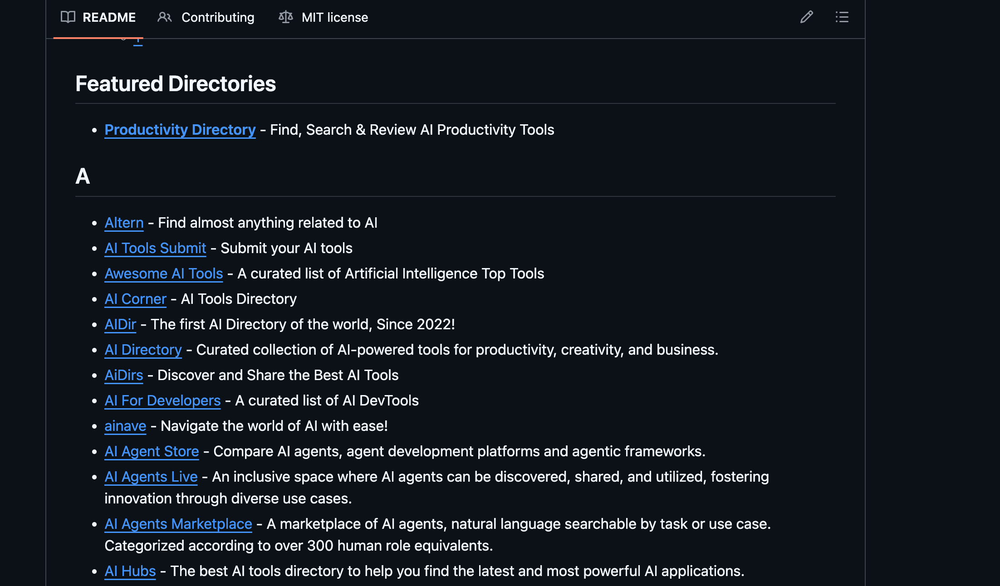

This GitHub repo is a curated list of AI directories where people can submit AI tools.

Building a product is one thing. Getting people to find it is another. If you are building an AI-related tool, directories can help with early discovery and launch distribution.

This is a useful repo to keep bookmarked if you are planning to launch or promote an AI product.

I would use it for:

- finding AI directories
- submitting an AI product
- planning launch distribution
- researching where similar tools are listed

## 15. [Patterns.dev](https://www.patterns.dev/)

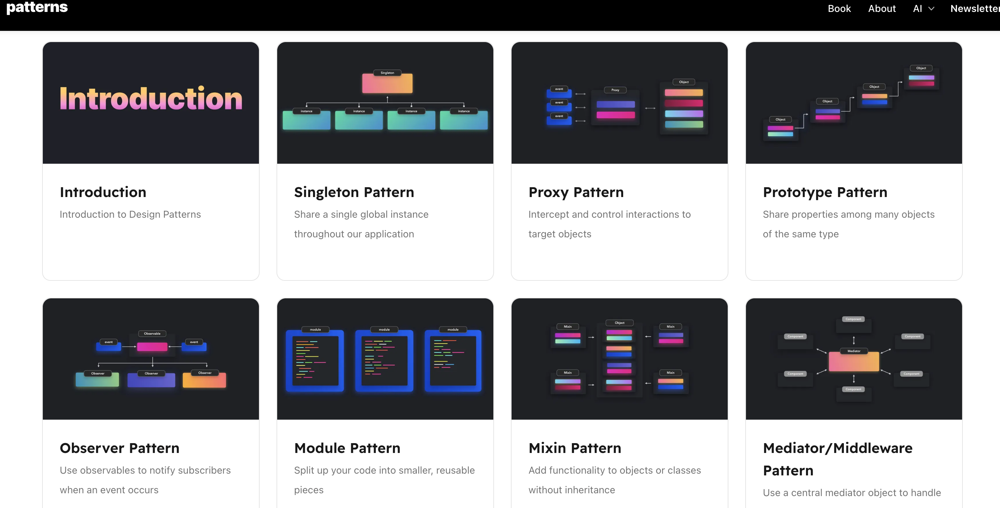

Patterns.dev is a learning resource for design, rendering, and performance patterns in web apps.

This is not something I open for a quick one-minute task. It is more of a resource I would read when I want to understand frontend architecture better.

Good tools improve your workflow, but good resources improve how you think. Patterns.dev fits into that second category.

I would use it for:

- learning JavaScript patterns
- understanding rendering patterns
- improving frontend architecture
- studying performance techniques

## 16. [An Introduction to Domain-Driven Design](https://khalilstemmler.com/articles/domain-driven-design-intro/)

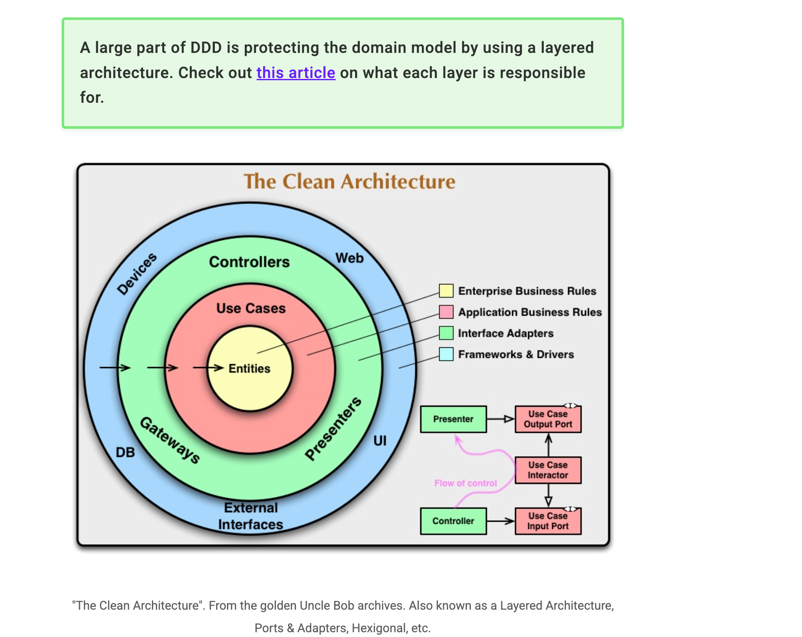

This is a good introduction to Domain-Driven Design.

DDD can sound heavy at first, but the basic idea is practical: understand the business domain and make the code reflect that domain clearly.

This becomes more useful when an app grows beyond simple CRUD and the business logic starts spreading everywhere.

I would use it for:

- understanding DDD basics
- organizing business logic better
- learning about entities, value objects, aggregates, and domain events
- thinking beyond simple controller-service-database code

## 17. [Software Engineering at Google](https://abseil.io/resources/swe-book/html/pr01.html)

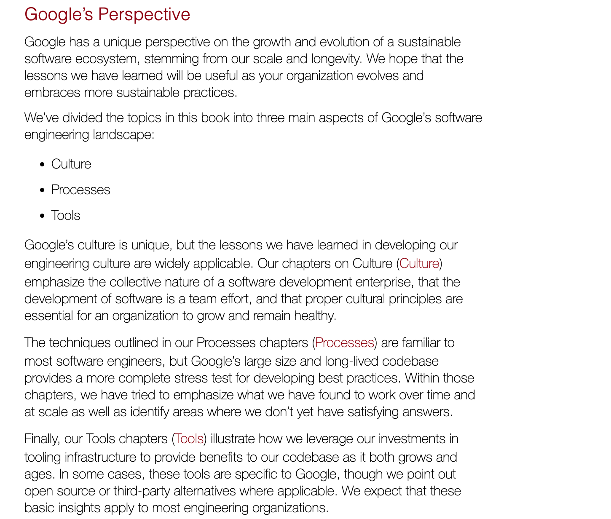

Software Engineering at Google is a free online book about building and maintaining software over time.

The part I like is how it separates programming from software engineering. Writing code is one part. Keeping that code useful, maintainable, and adaptable for years is the bigger challenge.

This is a good resource when you want to think more seriously about engineering practices, trade-offs, and long-term maintenance.

I would use it for:

- learning about software engineering at scale
- understanding maintainable codebases
- thinking about trade-offs and cost
- improving engineering habits

## 18. [LLMTEXT.com](https://llmtext.com/install)

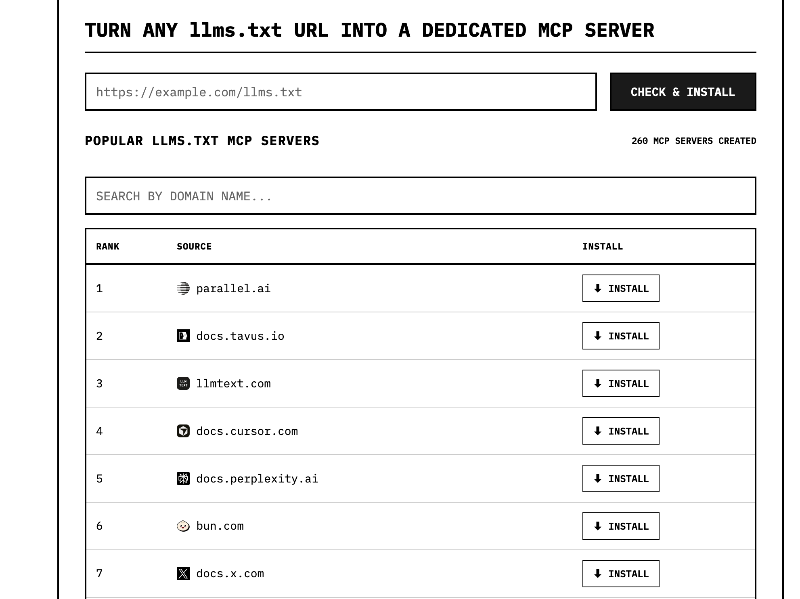

LLMTEXT.com is useful if you work with `llms.txt` and MCP servers.

The install page helps turn any `llms.txt` URL into a dedicated MCP server. That means an AI tool can use documentation in a more structured way instead of you copying and pasting the same docs again and again.

This becomes more useful when you use AI coding assistants regularly, because better context usually means better output.

I would use it for:

- installing `llms.txt` MCP servers
- connecting documentation to AI tools
- avoiding repeated doc copy-paste
- improving context for Claude, Cursor, or other LLM workflows

## Final thoughts

These are not the only developer tools out there, and I am not saying everyone should use all of them.

For me, the best tools are the ones that remove repeated friction. If a tool saves me from resizing the browser ten times, guessing which component is slow, drawing the same diagram from scratch, or waiting for an API before I can continue, then it is worth keeping in my workflow.

That is why I like collecting tools like this. Small improvements add up over time.

If you use any of these tools, or if you know a better alternative, share it in the comments. It will help others understand how these tools are actually improving real development workflows.
